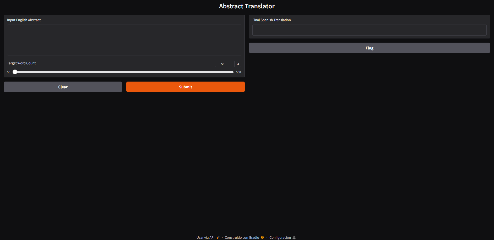
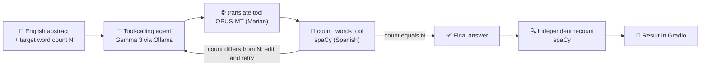

# 🌍 Abstract Translator (English → Spanish)

### Translate academic abstracts into Spanish and aim for an exact word count — with a local AI agent, private by design


-4285F4?style=flat-square)
-orange?style=flat-square)


| 🤖 Agentic | 🎯 Word-count target | 🔒 Private | 🐳 Portable |
|---|---|---|---|
| An LLM agent that calls tools and iterates | The final count is verified in code, not by the model | Inference runs on your machine through Ollama | Docker Compose with app + Ollama |




## 💡 Overview

A side project built in my spare time to cover a **real need**: translating an academic abstract into Spanish while keeping it at a specific number of words, something submission forms often require. Unpublished abstracts are also sensitive, so everything runs **locally**.

The work is split between three components:

- 🌐 a dedicated **translation model** (OPUS-MT, a Marian model) produces the Spanish text,
- 🔢 a **spaCy** tool counts the words deterministically (language models are unreliable at counting),
- 🤖 a small **LLM agent** (Gemma 3, 4B, via Ollama) orchestrates both tools and edits the text until the count matches your target.

When the agent finishes, the app recounts the words itself and shows you the verified number.

> [!NOTE]
> A 4B-parameter local model cannot guarantee an exact word count or a perfect translation. The app is designed so that you can **see and check** the real count, but you should always review the result. See **Model and Limitations** below.

## ✨ Features

- 🎯 **Target length:** choose between 50 and 500 words; the agent translates, counts and edits until it reaches it.
- 🛠️ **Two specialised tools:** one for translation, one for word counting, called by the agent.
- 🔍 **Independent verification:** the final word count is recalculated in code after the agent finishes.
- 🧠 **Agent reasoning shown:** the answer includes a short note on the adjustments made.
- 🔒 **Local inference:** the language model runs through Ollama; the translation model and spaCy run in the app.
- 🌐 **Web app (Gradio):** paste an abstract, move a slider, read the result.
- 🐳 **Docker Compose:** app and Ollama start together; the translation and spaCy models are baked into the app image.

## 🛠️ Technical Highlights

| | Area | What this project shows |
|:---|---|---|
| 🤖 | **Agentic AI** | A `smolagents` tool-calling agent that plans, calls tools and iterates until a constraint is met. A tool-calling agent was chosen over a code-writing one because a small local model is unreliable at writing code, and no model-generated code is executed |
| 🧩 | **Hybrid pipeline** | Each part does what it is good at: a specialised MT model translates, a deterministic NLP tool measures, and the LLM only orchestrates and edits |
| ✅ | **Verification** | The final count is recomputed with spaCy instead of trusting the model's own claim |
| 🔒 | **Privacy by design** | Local-first inference, models baked into the Docker image and offline mode at runtime (`HF_HUB_OFFLINE=1`) |
| 📦 | **Packaging** | Multi-stage Docker build, non-root user, Compose stack with a named model volume and GPU reservation for Ollama |
| ⚖️ | **Compliance** | Review of model terms and third-party licenses, including a copyleft (GPL) component |

**Stack:** Python · smolagents · LiteLLM · Ollama · Gemma 3 · Hugging Face Transformers · PyTorch · OPUS-MT · spaCy · Gradio · Docker Compose

## 📋 Requirements

| Element | Version | Description |
|---|---|---|
| 🐍 **Python** | 3.10 – 3.12 | `smolagents` needs 3.10+; the Docker image uses 3.12 |
| 🦙 **Ollama** | Latest | Local LLM runtime; must be running (default address `localhost`, port `11434`) |
| 🧠 **LLM** | `gemma3:4b-it-qat` | About 4 GB; **must be downloaded manually** with `ollama pull` (the app does not do it) |
| 🌐 **Translation model** | `Helsinki-NLP/opus-mt-en-mul` | About 300 MB; downloaded from Hugging Face on the first local run, baked into the image with Docker |
| 🔤 **Spanish spaCy model** | `es_core_news_sm` 3.7.0 | About 13 MB; GPL-3.0 licensed (see License) |
| 🤖 **smolagents** · **litellm** | Latest | Agent framework and the LiteLLM connector to Ollama |
| 🤗 **transformers** · **torch** · **sentencepiece** | transformers ≥ 4.50, < 5 | Loading and running the translation model (CPU is enough) |
| 📚 **spacy** | ≥ 3.7, < 3.8 | Word counting; the version must match the Spanish model |
| 🎛️ **gradio** | ≥ 5.0 | Web interface |
| 🧮 **RAM** | 8 GB min., 16 GB recommended | Gemma 3 4B plus the translation model |
| 🎮 **GPU** | Optional locally | Ollama uses an NVIDIA GPU if available. **Required for the provided Docker Compose file** (see Docker section) |
| 💾 **Disk space** | 15 GB free | Python packages (PyTorch is large), the models and the Docker images |
| 🌐 **Network** | First run only | One-time downloads of models and images |
| 🐳 **Docker + Compose** | Compose v2 *(optional)* | Only for the container option. With a GPU: NVIDIA drivers and the NVIDIA Container Toolkit (Linux/WSL2) |

Python packages are listed in `requirements.txt`.

## 🚀 Get Started

### 💻 Run locally

1. **Install Ollama** from [ollama.com](https://ollama.com) and make sure it is running.
2. **Download the language model** (about 4 GB, once): `ollama pull gemma3:4b-it-qat`

```bash
# 3. Clone the repository
git clone https://github.com/polendol/Abstract_Translator.git
cd Abstract_Translator

# 4. Create and activate a virtual environment
python -m venv .venv
source .venv/bin/activate          # Windows: .venv\Scripts\activate

# 5. Install the dependencies
pip install -r requirements.txt

# 6. Install the Spanish spaCy model
python -m spacy download es_core_news_sm

# 7. Start the web app
python AbstractTranslator.py
```

The app runs on `localhost`, port `7860` by default, and is only reachable from your own computer. Open `http://localhost:7860` in your browser (never `http://0.0.0.0:7860`, which browsers cannot open). If that port is busy, Gradio picks the next free one and prints it in the terminal.

> [!TIP]
> The first start is slow: the app downloads the translation model (about 300 MB) from Hugging Face and loads it together with spaCy. The first request after Ollama has been idle also takes longer while Gemma is loaded into memory.

### 🐳 Run with Docker

```bash
git clone https://github.com/polendol/Abstract_Translator.git
cd Abstract_Translator

# Build and start both services
docker compose up -d --build

# Download the language model into the Ollama container (once)
docker compose exec ollama ollama pull gemma3:4b-it-qat
```

Then open `http://localhost:7860` in your browser.

> [!IMPORTANT]
> The Gradio log prints `http://0.0.0.0:7860`. That is the address *inside* the container and it **does not work in a browser** (you get an `ERR_ADDRESS_INVALID` error). Always open `http://localhost:7860` instead.

- The first build takes a while: it installs PyTorch and bakes the translation model and the Spanish spaCy model into the image. At runtime the app container does not download anything from Hugging Face.
- The language model is stored in a named volume (`ollama`), so it is downloaded only once. `docker compose down` stops everything; add `-v` to also delete the downloaded model.
- Only Ollama benefits from the GPU. The translation model and spaCy run on the CPU.

> [!IMPORTANT]
> The provided `docker-compose.yml` **reserves an NVIDIA GPU**, so `docker compose up` fails on machines without one (or without the NVIDIA Container Toolkit; Docker Desktop on Windows handles this with the WSL2 backend and current drivers). Without a GPU, remove the two `deploy:` blocks from the Compose file and everything runs on the CPU, only much slower.

> [!WARNING]
> With the provided `docker-compose.yml`, port `7860` is published on all network interfaces of the host, so other devices on the same network can also reach the app, and it has no authentication. Use it on trusted networks only. To restrict it to your own computer, change the port mapping to `127.0.0.1:7860:7860`. The Ollama service itself is **not** published to the host.

## 🎮 Usage

### 🌐 Web interface

1. Paste the **English abstract** into the text box.
2. Move the slider to the **target word count** (50 to 500, in steps of 10).
3. Submit and wait. The agent makes several model calls, so it can take from a few seconds to a few minutes, longer on CPU.
4. Read the result: the agent's short reasoning, the Spanish abstract, its own word count and, at the end, the **verified count** calculated by the app.

### ⚙️ Configuration

| Variable | Default | Description |
|---|---|---|
| `OLLAMA_API_BASE` | `http://localhost:11434` | Address of the Ollama server (Docker Compose sets `http://ollama:11434`) |
| `HF_HUB_OFFLINE` | not set (set to `1` in the Docker image) | Set to `1` after the first download to stop Hugging Face Hub checks |
| `GRADIO_ANALYTICS_ENABLED` | enabled | Set to `False` to turn off Gradio's anonymous usage analytics |

The language model is set in `AbstractTranslator.py` (`LiteLLMModel(model_id=...)`). Other Ollama models can be used, but reliability when calling tools and following the output format varies between models.

> [!CAUTION]
> If you point `OLLAMA_API_BASE` at another machine, your abstract is sent to that machine. Keep the default for fully local processing.

## 📄 Example Output

```text
[Reasoning]: <short note on the adjustments made to reach the target length>
[Final Spanish Abstract]: <the Spanish abstract>
[Word Count]: El resumen tiene 150 palabras.

Final count: 150 words
```

*Illustrative. The agent writes the first three parts in free text, so wording can vary between runs.*

| Part | Meaning |
|---|---|
| 🧠 **[Reasoning]** | Short note, in English, on how the text was adjusted |
| 🇪🇸 **[Final Spanish Abstract]** | The translated abstract |
| 🗣️ **[Word Count]** | The agent's own claim about the length |
| ✅ **Final count** | Added by the app: the abstract is recounted with spaCy, independently of the model |

## ⚙️ How It Works



The agent receives the abstract and the target length and follows a fixed procedure. The two tools are plain Python functions registered with `smolagents`.

<details>
<summary>Show the agent's instructions (summary)</summary>

| Step | Instruction |
|---|---|
| 1. Translate | Translate the abstract into academic Spanish with the `translate` tool |
| 2. Count | Count the words of the translation with the `count_words` tool |
| 3. Iterate | If the count is not the target, shorten with more concise academic phrasing or expand with formal descriptions |
| 4. Validate | Call `count_words` one last time before finishing |
| Constraints | Final output 100% in Spanish; do not summarize; keep the original meaning; state the final word count |
| Output format | `[Reasoning]`, `[Final Spanish Abstract]`, `[Word Count]` |

The app then extracts the text between `[Final Spanish Abstract]` and `[Word Count]` and counts its alphabetic tokens with spaCy.

</details>

## 🧠 Model and Limitations

| | Component | Role |
|:---|---|---|
| 🧠 | **[Gemma 3](https://ai.google.dev/gemma) 4B** (`gemma3:4b-it-qat`) | Orchestrates the tools and edits the text. Runs locally through Ollama; quantization-aware-trained build with a smaller memory footprint |
| 🌐 | **[OPUS-MT](https://huggingface.co/Helsinki-NLP/opus-mt-en-mul) `opus-mt-en-mul`** | Multilingual English → many languages Marian model. Its model card reports about 37 BLEU on the Tatoeba test set and 23–28 BLEU on the news test sets for English → Spanish |
| 🔤 | **spaCy `es_core_news_sm`** | Spanish tokenization for the word count |

**No model weights are stored in this repository.** Models are downloaded by each user from their official sources.

> [!WARNING]
> **Review every translation.** The translation comes from a general-purpose multilingual model, not one specialised in scientific text, and a 4B agent decides the final edits. Terminology can be wrong, and editing to reach a word count can change nuance or drop details. Compare the result with the original before using it.

Other known limits:

- 🎯 **Exact counts are not guaranteed.** A small model may stop close to the target or run out of steps. That is why the app reports the real count, so check it before submitting.
- 🔢 **What counts as a word:** the count uses spaCy tokens made only of letters. Numbers, symbols and punctuation are not counted, and hyphenated or compound forms may be split differently from Word or a journal portal, so the number can differ slightly from other counters.
- ✂️ **Long inputs:** the translation tool truncates its input at 512 tokens (roughly 350 words), so a longer abstract is cut without warning. OPUS-MT models are also mostly trained on sentence-level data, so very long passages can lose or repeat content.
- 📏 **Extreme targets:** a target far from the natural length forces heavy padding or cutting.
- 🧾 **Format dependence:** the verified count is only added when the agent keeps the `[Final Spanish Abstract]` / `[Word Count]` format.
- 💉 **Prompt injection:** the abstract is inserted directly into the agent's prompt, so text that looks like instructions can steer the model. The agent only has two harmless tools and no code execution.
- 🇬🇧➡️🇪🇸 **One direction:** English → Spanish only.
- 🔁 **Several model calls per request**, so it is slow, especially without a GPU.

## 🔒 Privacy

- 🏠 The abstract is processed locally: the agent model runs in Ollama, and the translation and counting models run inside the app. Nothing is sent to a third-party service.
- 📡 Outbound connections happen only for downloads: the models (Hugging Face, Ollama, GitHub for the spaCy model) and the Docker images. With Docker, the translation and spaCy models are baked into the image, and the app container runs in Hugging Face offline mode.
- 🌐 Running locally, `transformers` may check Hugging Face Hub for updates on each start. Set `HF_HUB_OFFLINE=1` after the first download to avoid it.
- 📊 Gradio sends anonymous usage analytics by default; disable them with `GRADIO_ANALYTICS_ENABLED=False`.
- 🚫 The Gradio "Flag" button is disabled, so inputs and outputs are not saved to disk by the app.
- 🖥️ The agent framework prints its steps to the console, including the abstract and intermediate translations. With Docker they end up in the container logs (`docker compose logs`).
- 🌐 **Network exposure:** run locally (`python AbstractTranslator.py`), the web app listens on `localhost` only. With Docker, the provided `docker-compose.yml` publishes port `7860` on all host network interfaces, so other devices on your network can reach it. The app has no authentication, so use Docker on trusted networks or publish the port as `127.0.0.1:7860:7860` to keep it private. The Ollama API is not published.
- 🔌 **Remote Ollama:** if you set `OLLAMA_API_BASE` to another machine, your text travels to that machine.
- 🐳 The Docker image contains only the two source files (`AbstractTranslator.py` and `tools.py`); nothing else from the project folder is copied into it.

## 🗂️ Project Structure

```text
.
├── AbstractTranslator.py   # Gradio app and tool-calling agent
├── tools.py                # translate and count_words tools
├── requirements.txt        # Python dependencies
├── Dockerfile              # Multi-stage, python:3.12-slim, non-root user (app)
├── docker-compose.yml      # App + Ollama, named model volume, NVIDIA GPU reservation
├── LICENSE                 # MIT License
└── README.md               # This file
```

## 🗺️ Roadmap

- [ ] 🌐 Compare with the bilingual English → Spanish OPUS-MT model and measure quality (BLEU / chrF) on a set of abstracts
- [ ] 🎯 Measure how often the agent hits the exact target, and add a tolerance option (± n words)
- [ ] ✂️ Split long abstracts into sentences before translating to avoid truncation
- [ ] 🌍 Choose the target language (the OPUS-MT model supports many)
- [ ] 🔀 Choose the Ollama model without editing the code
- [ ] 📑 File upload (`.txt`, `.pdf`)
- [ ] 💻 CPU-only Compose override file
- [ ] ❤️‍🩹 Health check and automatic model download in Docker Compose
- [ ] 📌 Pinned dependency versions for reproducible builds
- [ ] ✅ Automated tests and CI

## ⚠️ Responsible Use

> [!CAUTION]
> This tool produces machine-generated translations. Review them before submitting, especially terminology, numbers and meaning, and check the word count with your submission system. Some journals and conferences have policies on AI-assisted translation or editing that may require disclosure.

## ⚖️ License

Released under the **[MIT License](LICENSE)**. Copyright (c) 2026 Paulina Olender.

The MIT License covers **only this project's own code and documentation**. Third-party models and libraries are not redistributed here and keep their own terms.

> This software is provided "as is", without warranty of any kind. This is an independent project, not affiliated with or endorsed by Google, Hugging Face, the University of Helsinki (Helsinki-NLP), Explosion, Ollama, Gradio or Docker. Gemma is a trademark of Google. All product names and trademarks belong to their respective owners.

### 📜 Third-Party Licenses

| Component | Role | License | Notes |
|---|---|---|---|
| [Gemma 3](https://ai.google.dev/gemma) (`gemma3:4b-it-qat`) | Agent language model | ⚠️ **[Gemma Terms of Use](https://ai.google.dev/gemma/terms)** and **[Prohibited Use Policy](https://ai.google.dev/gemma/prohibited_use_policy)**, a custom license and not an open-source one (terms last modified 1 Apr 2026, checked 13 Oct 2026) | Not included in this repository or in any image. Each user downloads the model through Ollama and is bound by these terms. |
| [Helsinki-NLP/opus-mt-en-mul](https://huggingface.co/Helsinki-NLP/opus-mt-en-mul) | Translation model | Apache 2.0 (as stated on the model card, checked 14 Oct 2026) | Downloaded from Hugging Face on first run; baked into the app image at build time with Docker |
| [`es_core_news_sm`](https://spacy.io/models/es#es_core_news_sm) 3.7.0 | Spanish spaCy pipeline | ⚠️ **GNU GPL 3.0** (as stated in the package metadata, checked 14 Oct 2026) | Trained on UD Spanish AnCora (GPL-3.0), WikiNER (CC BY 4.0) and spaCy lookups data (MIT). Not included in this repository; installed from the official release. |
| [spaCy](https://github.com/explosion/spaCy) | NLP library | MIT | |
| [smolagents](https://github.com/huggingface/smolagents) | Agent framework | Apache 2.0 | |
| [LiteLLM](https://github.com/BerriAI/litellm) | Connector to Ollama | MIT | The `enterprise/` directory of its repository has a separate license and is not used here |
| [Ollama](https://github.com/ollama/ollama) | Local LLM runtime | MIT | Also distributed as the `ollama/ollama` Docker image |
| [Transformers](https://github.com/huggingface/transformers) | Model loading | Apache 2.0 | |
| [PyTorch](https://github.com/pytorch/pytorch) | Deep learning library | BSD-style | Linux wheels install NVIDIA CUDA runtime packages under NVIDIA's own terms |
| [SentencePiece](https://github.com/google/sentencepiece) | Tokenizer | Apache 2.0 | |
| [Gradio](https://github.com/gradio-app/gradio) | Web interface | Apache 2.0 | |

> [!NOTE]
> **GPL-3.0 component:** the Spanish spaCy model is GPL-3.0. This repository does not include it, but if you build and **distribute** a Docker image or any other bundle that contains it, GPL-3.0 conditions apply to that component. The Gemma terms also apply to anyone who uses the model, including people who use it through a service you host, and other Gemma generations may be under different terms. Read them before hosting this app for others or switching models. This is not legal advice.

The Docker setup is built locally from the official `python:3.12-slim` image (Python Software Foundation License, plus Debian packages under their own licenses) and the official `ollama/ollama` image; no image is distributed with this repository.

## 🙏 Acknowledgments

Thanks to the **Google DeepMind** team for Gemma, to the **Helsinki-NLP** group at the University of Helsinki for the OPUS-MT models, to **Explosion** for spaCy, to the **Hugging Face** team for `transformers` and `smolagents`, to the **Ollama**, **LiteLLM** and **Gradio** maintainers.

## 📚 Citation

If you build on the underlying models, please cite:

- Gemma Team, Google DeepMind. *Gemma 3 Technical Report.* [arXiv:2503.19786](https://arxiv.org/abs/2503.19786)
- Tiedemann, J. and Thottingal, S. *OPUS-MT – Building open translation services for the World.* Proceedings of EAMT 2020.
- Tiedemann, J. *The Tatoeba Translation Challenge – Realistic Data Sets for Low Resource and Multilingual MT.* Proceedings of WMT 2020. [arXiv:2010.06354](https://arxiv.org/abs/2010.06354)

## 👤 Author

**`Paulina Olender`** — NLP / Machine Learning

Feedback, issues and suggestions are welcome. If this tool is useful to you, a ⭐ is appreciated.
